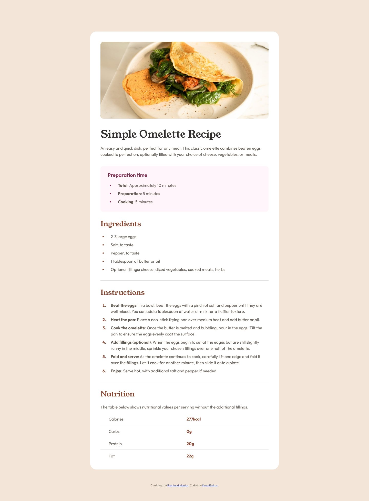

# Frontend Mentor - Recipe page solution

This is a solution to the [Recipe page challenge on Frontend Mentor](https://www.frontendmentor.io/challenges/recipe-page-KiTsR8QQKm). Frontend Mentor challenges help you improve your coding skills by building realistic projects.

## Table of contents

- [Overview](#overview)
  - [Screenshot](#screenshot)
  - [Links](#links)
- [My process](#my-process)
  - [Built with](#built-with)
  - [Workflow](#workflow)
  - [What I learned](#what-i-learned)
  - [Continued development](#continued-development)
  - [Useful resources](#useful-resources)
  - [AI Collaboration](#ai-collaboration)
- [Author](#author)

## Overview

### Screenshot



### Links

- Live Site URL: [ounokoya.github.io/recipe-page](https://ounokoya.github.io/recipe-page/)

## My process

### Built with

- Semantic HTML5: an `article` with sections named by their headings, unordered lists for the times and ingredients, an ordered list for the steps (each starting with a `strong` label), a table with row headers for the nutrition values
- [Tailwind CSS v4](https://tailwindcss.com/) — design tokens in `@theme`, default palette removed, named utilities (`section-title`, `recipe-list`, `nutrition-table`, `link`)
- Young Serif and Outfit served with the site from the starter's font files
- Native list markers styled with `::marker`, so screen readers still announce the bullets and the step numbers
- Mobile-first layout: full-width photo below 768 px, a 736 px card from 768 px (my tablet proposal, no design provided)
- [Vite](https://vite.dev/) for the build, deployed on GitHub Pages from the `gh-pages` branch (`npm run deploy`)
- [Playwright](https://playwright.dev/), [axe-core](https://github.com/dequelabs/axe-core), the W3C Nu validator, html-validate and ESLint for tests

### Workflow

Before any code, the design was analysed and rebuilt:

1. **Visual analysis in Excalidraw** — measurements in px, contrast checks, the HTML tree → [`specs/visuel/`](./specs/visuel/)
2. **Penpot mockup** — library, desktop, mobile and tablet screens, visual thresholds calibrated against the design JPGs → [`specs/visuel/penpot/`](./specs/visuel/penpot/)
3. **Spec, then tests** — 20 Given/When/Then scenarios and the accessible names the tests rely on → [`specs/specifications/`](./specs/specifications/); the tests were written before the code and checked to fail on the starter
4. **Decisions** — tokens, fonts, one photo for every width, native lists and table → [`specs/adr/`](./specs/adr/)
5. **Code** — one commit per part (structure, mobile, desktop, states), then a walk-through in a real browser → [`specs/analyse/`](./specs/analyse/)

### What I learned

**Moving a list marker away from its text.** An outside marker sits against the edge of its list item, so the item's own left padding sets the gap between the bullet and the text:

```css
@utility recipe-list {
  padding-left: 1.5625rem;
  & > li {
    padding-left: 0.9375rem; /* the bullet stays here, the text moves 32 px away */
  }
}
```

**Why a line wrapped earlier than in the design.** On Linux, Chromium rounded each glyph of the starter's TTF fonts to whole pixels: the second line of the introduction grew from 310.9 to 317 px and no longer fitted in 311 px. `text-rendering: geometricPrecision` keeps the fractional widths, and every line now breaks where the design breaks it.

**A table is the right element for the nutrition values.** With `th scope="row"`, a screen reader announces "Calories, 277kcal" instead of two unrelated words.

### Continued development

- **Visual comparison with the design files.** Screenshots differ from the Frontend Mentor JPGs by 0.4 % (desktop) and 4.4 % (mobile) of pixels; the mobile threshold is 6.8 %, because the narrow column is almost entirely made of thin letters.
- The design centres the bullets of two-line items; the page aligns them with the first line, as in a usual list.
- **Tablet**: my own proposal, the desktop card centred from 768 px.

### Useful resources

- [MDN — `::marker`](https://developer.mozilla.org/en-US/docs/Web/CSS/::marker) — styling bullets and numbers.
- [MDN — `text-rendering`](https://developer.mozilla.org/en-US/docs/Web/CSS/text-rendering) — unrounded glyph widths.
- [W3C WAI — Tables with two headers](https://www.w3.org/WAI/tutorials/tables/two-headers/) — row headers in a data table.

### AI Collaboration

I used **Claude (Claude Code)** as a pair, inside my own spec-driven workflow where I validated each step before the next one:

- **Planning**: Claude listed my unfinished challenges and my old solutions that needed work, and wrote the plan, which I validated.
- **Design analysis and mockup**: Claude measured the JPG designs, drew the annotated Excalidraw analysis and built the Penpot mockup; I reviewed both and decided on the bullets, the table markup, the image description and the tablet layout.
- **Spec and tests**: written by Claude before any code, from the validated mockup.
- **Technical decisions**: the starter's font files, as in my common stack decision.
- **Code**: written by Claude from the spec — I confirmed this split at the code lock — one commit per part, with the tests run at each step.

What worked well: comparing each line of the page with the design explained every difference before it was fixed. What needed my decisions: the choices listed above.

## Author

- Frontend Mentor - [@ounokoya](https://www.frontendmentor.io/profile/ounokoya)
- GitHub - [@ounokoya](https://github.com/ounokoya)
